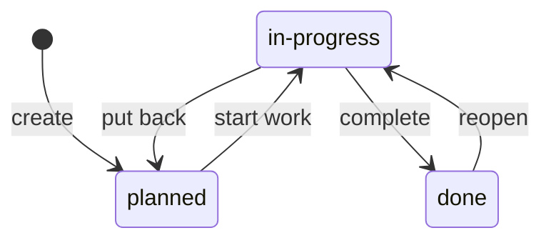
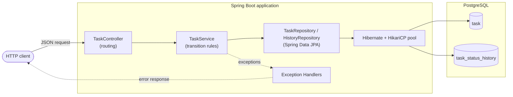

# Production Task Manager

[]()
[]()
[]()
[]()

A task-tracking REST API that treats every task as a workflow item with a
controlled lifecycle and a full audit trail, rather than a plain CRUD record.

### Task lifecycle



| From \ To | planned | in-progress | done |
|---|---|---|---|
| **planned** | – | ✓ | ✗ |
| **in-progress** | ✓ | – | ✓ |
| **done** | ✗ | ✓ | – |

- A new task must start as `planned`; any other initial status is rejected (400).
- Tasks cannot skip `in-progress`, so the history always records when work started.
- A finished task can be reopened, but only back to `in-progress`.
- An illegal transition returns **409 Conflict** and names the current and requested status.

### Audit trail

Every status change writes one row to `task_status_history`:
task, previous status, new status, timestamp. Task creation is recorded as
`null → planned`.

- Rows are insert-only at the application level (non-updatable fields, no update/delete paths).
- Indexed on `(task_id, changed_at)` for fast "history of this task" lookups.
- Deleting a task removes its history via `ON DELETE CASCADE`.

## Architecture



## Tech Stack

**Implemented**
- Java 17
- Spring Boot 4.1.0
- PostgreSQL — persistent storage

**Planned**
- Docker / Docker Compose — containerization
- Nginx — reverse proxy
- GitHub Actions — CI/CD
- Prometheus + Grafana — metrics & dashboards
- AWS — deployment

## API

| Method | Endpoint | Description |
|---|---|---|
| `GET` | `/tasks` | List all tasks |
| `GET` | `/tasks/{id}` | Fetch a single task |
| `POST` | `/tasks` | Create a task |
| `PUT` | `/tasks/{id}` | Update a task |
| `DELETE` | `/tasks/{id}` | Delete a task |

A task has a `title` (required), an optional `description`, a `status` (`planned`, `in-progress`, or `done`), and a server-generated `id` and `createdAt`. Clients cannot supply the generated fields.

## Getting started

### Prerequisites

You will need JDK 17, Maven 3.9+ and a PostgreSQL instance running locally.

### 1. Clone the repository

```bash
git clone <repo-url>
cd production-task-manager
```

### 2. Create the database

```bash
createdb taskmanager
```

### 3. Configure the connection

The application reads its datasource settings from the standard Spring environment variables. If your local PostgreSQL runs on the default port with a passwordless user, the defaults may work as they are. Otherwise, set these before starting:

```bash
export SPRING_DATASOURCE_URL=jdbc:postgresql://localhost:5432/taskmanager
export SPRING_DATASOURCE_USERNAME=your_user
export SPRING_DATASOURCE_PASSWORD=your_password
```

### 4. Run the application

```bash
./mvnw spring-boot:run
```

The API starts on `http://localhost:8080`.

### 5. Try it out

```bash
# Create a task
curl -X POST http://localhost:8080/tasks \
  -H "Content-Type: application/json" \
  -d '{"title": "Write the README", "description": "Cover Postgres setup", "status": "planned"}'

# List all tasks
curl http://localhost:8080/tasks
```

Restart the application and list the tasks again to confirm they survived.

## Project status

The core service is complete: Spring Boot migration, CRUD endpoints, validation, centralized error handling, and PostgreSQL persistence through JPA and Hibernate. What remains is the work that turns a working service into a production one.

| Phase | Status |
|---|---|
| Raw `HttpServer` → Spring Boot migration | ✅ Complete |
| `TaskController` + core CRUD | ✅ Complete |
| Service layer (Spring-managed) | ✅ Complete |
| Validation & error handling | ✅ Complete |
| PostgreSQL persistence | ✅ Complete |
| Testing (unit + integration) | ⏳ Planned |
| Containerization (Docker) | ⏳ Planned |
| CI/CD (GitHub Actions) | ⏳ Planned |
| Observability (Prometheus + Grafana) | ⏳ Planned |
| Deployment (AWS) | ⏳ Planned |

## Roadmap

The next milestone is a proper test suite, covering the service logic with unit tests and the HTTP-to-database path with integration tests against a real PostgreSQL instance. After that, the application and its database will be containerized with Docker Compose, which also replaces the manual local Postgres setup above. A GitHub Actions pipeline will then build and test every change, Prometheus and Grafana will add metrics and dashboards, and the final step is deploying the whole stack to AWS behind an Nginx reverse proxy.

1. ✅ Migrate off raw `com.sun.net.httpserver` to Spring Boot
2. ✅ Implement `TaskController` and core CRUD endpoints
3. ✅ Wire up PostgreSQL persistence (JPA/Hibernate)
4. ⏳ Add request validation and centralized error handling
5. ⏳ Write unit and integration tests
6. ⏳ Containerize with Docker + Docker Compose
7. ⏳ Set up CI/CD via GitHub Actions
8. ⏳ Add Prometheus metrics and Grafana dashboards
9. ⏳ Deploy to AWS